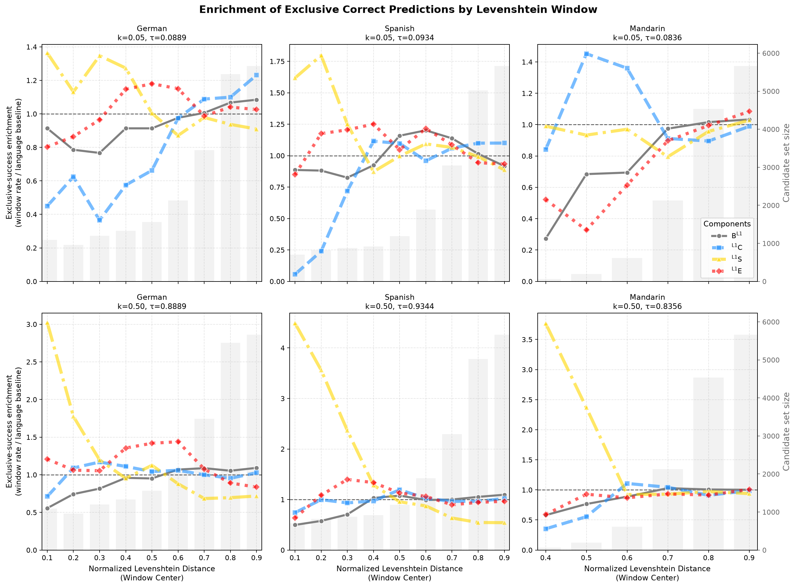

This is the repository associated with the paper "Noah-Manuel Michael, Anna Hülsing, and Andrea Horbach. 2026. Etymology Can Inform Lexical Complexity Prediction. In Proceedings of the 15th Workshop on Natural Language Processing for Computer Assisted Language Learning, pages 173–196, Gothenburg, Sweden. University of Tartu Library."

---

## Quick Overview

**Research Questions**:  
- What is the predictive potential of etymology features in LCP, both alone and combined with existing features?  
- To what extent do etymology features contribute information distinct from features previously employed in LCP?  
- Is there a specific NLD range where etymology features are most effective, and does it vary across L1s?
- To what extent do etymology features, alone or combined with existing features, further improve a transformer baseline in LCP?  

**Dataset**: 2026 BEA shared-task dataset on vocabulary difficulty prediction for English learners (German, Spanish, Mandarin → English)  
**Models**: (XLM-RoBERTa →) LightGBM  
**Validation**: 5-fold outer × 4-fold inner CV  
**Contribution**: 9 GPT-5.6-Luna-generated etymology features derived from Wiktionary etymologies, evaluated alongside surface-similarity and common lexical features in a stacked RoBERTa-LightGBM architecture.

## Findings

Etymology features improve prediction across most model configurations for German, Spanish, and Mandarin. Their contribution is clearest for German and Spanish at moderate surface distances (NLD 0.3–0.7); for Mandarin, gains are less concentrated. This suggests etymological information complements surface similarity, particularly when related words look less alike.



## Abstract

In Lexical Complexity Prediction (LCP) for second-language learners, cross-linguistic cognacy and borrowing relationships are commonly approximated using surface similarity. However, historical sound changes and orthographic differences can obscure etymological relationships that still facilitate vocabulary production. We investigate whether etymology-based features improve LCP for learners of English with German, Spanish, or Mandarin as source languages, using the 2026 BEA shared-task dataset. We expect etymological information to be most informative for German and Spanish, where historical relationships with English are frequent but often obscured by divergence. 
Mining Wiktionary etymologies, we derive nine etymology features for source-target word pairs, evaluated alongside surface-similarity and common lexical features in a stacked RoBERTa-LightGBM architecture. Across most configurations, adding etymology information significantly improves prediction performance for all three languages. For German and Spanish, the clearest contribution occurs for word pairs with normalized Levenshtein distances (NLDs) between $0.3$ and $0.7$, where surface similarity becomes less reliable, but common lexical features are not yet dominant. For Mandarin, etymology features remain useful, though less localized across NLD ranges. Our findings indicate that etymology effectively complements standard LCP approaches when surface similarity becomes less informative.

## Reproduction
To reproduce our results, please follow the steps below in the specified order.

In your environment, install:  
```bash
pip install -r requirements.txt
```

Additional resources required:

- `data/original/SUBTLEX-UK.xlsx` (SUBTLEX-UK frequencies; used by `features/established/generate_established_LCP_features.py`)
- `features/similarity/cedict_ts.u8` (CC-CEDICT file for Mandarin transliteration in similarity features)
- Wiktionary JSONL extracts for the English, German, Spanish, and Chinese editions in `features/relatedness/`, named `en-extract.jsonl.gz`, `de-extract.jsonl.gz`, `es-extract.jsonl.gz`, and `zh-extract.jsonl.gz`
- OpenAI API key via `features/relatedness/open_api_key.txt` (used by `features/relatedness/generate_relatedness_features.py`)
- Local `xlm-roberta-base` checkpoint for RoBERTa training/prediction (set `PRETRAINED_MODEL_PATH` in `models/roberta_cv_utils.py`)

### Data Preparation and Feature Generation

Run from the repository root:
```bash
python data/pooling.py
python data/preprocessing.py
python features/similarity/generate_similarity_features.py
python features/established/generate_established_LCP_features.py
python features/relatedness/wiktionary_parse.py  
python features/relatedness/generate_relatedness_features.py
python features/relatedness/fill_na.py
python data/feature_enriched/generate_full_dataset.py
python data/feature_enriched/folds/generate_folds.py
python features/similarity/generate_cosine_sim_feature.py
```

### XLM-RoBERTa Training

From the repository root, train the five outer-fold models and their inner-fold models using the HPC submission script, then generate predictions:

```bash
bash models/submit_roberta_finetune.sh
python models/predict_roberta_cv.py --folds-dir data/feature_enriched/folds \
  --models-dir models/roberta_models --output-dir models/roberta_predictions
```

The submission script requires adapting its paths and Slurm settings to your HPC system.
Training uses 5 epochs, batch size 32, maximum sequence length 256, and seed 667.

### LightGBM Experiments

Run from the repository root, in order:

```bash
python models/train_lightgbm_final.py
python models/predict_lightgbm_final.py
python results/evaluate_lightgbm_final.py
python results/plot_lightgbm_final.py
python results/plot_lightgbm_final_individual.py
```

## Citation

BibTex:  
@inproceedings{michael2026etymology,  
  title     = {Etymology Can Inform Lexical Complexity Prediction},  
  author    = {Michael, Noah-Manuel and Hülsing, Anna and Horbach, Andrea},  
  booktitle = {Proceedings of the 15th Workshop on NLP for Computer-Assisted Language Learning (NLP4CALL)},  
  year      = {2026},  
  publisher = {LiU Electronic Press},  
  note      = {In press},  
}
